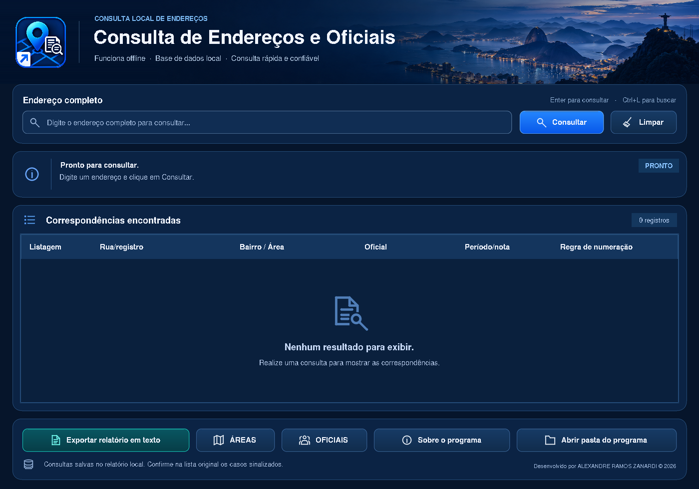

# Consulta de Endereços e Oficiais

Aplicativo desktop offline em Python/Tkinter para consultar ruas, áreas e oficiais.
Esta versão refina o layout azul inspirado na referência enviada, sem o botão
“Ler mandado”. As regras de consulta e os arquivos de dados originais foram
preservados.



A versão 2 inclui um panorama do Rio, painéis e botões com bordas suaves,
fontes mais legíveis e indicadores PRONTO, LOCALIZADO e CONFERIR. Atalhos:
**Enter** para consultar, **Ctrl+L** para buscar e **Esc** para limpar.
A pasta `recursos` contém as imagens locais, sem novas dependências de execução.

## Baixar para o Windows

O pacote pronto para extração está em
[distribuicao/Consulta_Enderecos_Layout_Azul_v2.zip](distribuicao/Consulta_Enderecos_Layout_Azul_v2.zip).

1. Abra esse arquivo no GitHub e clique em **Download raw file** (ícone de download).
2. No Windows, clique com o botão direito no ZIP e escolha **Extrair Tudo**.
3. Abra a pasta `Consulta_Enderecos_Oficiais` que foi extraída.

Outra opção é usar **Code → Download ZIP** na página principal do repositório.
Nesse caso, o código fica na subpasta `Consulta_Enderecos_Oficiais`, e o pacote
original também fica disponível em `distribuicao`.

Se o repositório for privado, entre no GitHub com a conta que tem acesso a ele.

## Executar ou gerar o executável

Com Python 3.11 ou superior e Tkinter instalados, execute dentro da pasta do programa:

```console
python consulta_enderecos.py
```

Para gerar o `.exe`, execute `CRIAR_EXE_NO_WINDOWS.bat` **no Windows**. O resultado
fica em `dist\ConsultaEnderecos\ConsultaEnderecos.exe`. Mantenha a pasta `recursos` e os arquivos de
dados e imagens na pasta do programa, conforme o `LEIA-ME.txt` original.

Antes de substituir uma instalação antiga, preserve seus ajustes, seu histórico
e qualquer base personalizada. Veja `LEIA-ME_LAYOUT_AZUL.txt` para detalhes.

## Validação

Os testes existentes em `testar_programa.py` passaram com 1.491 registros.
A interface, consultas, histórico CSV, exportação TXT e janelas auxiliares
também foram validados em Linux com tela virtual. O executável Windows precisa
ser gerado no Windows; ele não está incluído neste pacote.

## Integridade do pacote

Arquivo: `distribuicao/Consulta_Enderecos_Layout_Azul_v2.zip` — 1.940.829 bytes.

SHA-256:

```text
fffddf3180880353102ec9dfbf454da467741a05dcaab02b2767530deb285432
```

A primeira versão continua em `distribuicao/Consulta_Enderecos_Layout_Azul.zip`
para quem precisar recuperar o pacote anterior.
